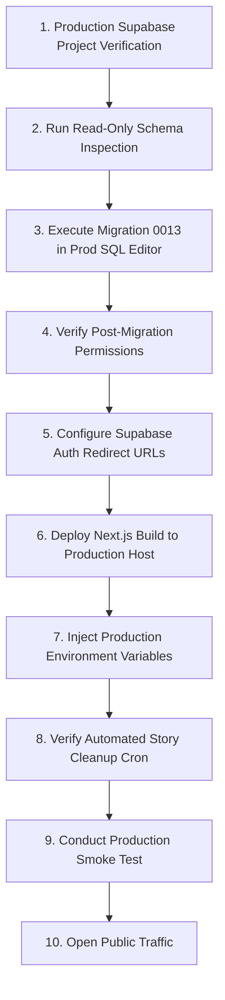

# EVOAIQU — Production Readiness Gate Audit Report

**Audit Date:** October 21, 2026  
**Auditor:** EVOAIQU Quality & Security Engineering  
**Scope:** Full Production Readiness Gate Audit (Migrations, RLS Policies, RPC Grants, Story Media Lifecycle, Authentication & Session Security, Server Secrets, Hosting Architecture, Observability, and Disaster Recovery)  
**Read-Only Guarantee:** Zero production database mutations executed; zero production secrets, tokens, emails, or credentials exposed; zero destructive migrations applied.  
**Gate Decision:** **READY AFTER FIXES** (Codebase & Staging 100% Passed; Gated on Operator Pre-Launch Production Configuration & Migration 0013 Execution)

---

## 1. Executive Summary & Verification Environment

A comprehensive production readiness audit of the **EVOAIQU** gaming platform was conducted following the successful acceptance of the Rock Paper Scissors (RPS) Arena redesign and multiplayer audit.

### Staging vs. Production Distinction

> [!IMPORTANT]
> **Strict Environmental Separation Principle:**  
> Staging verification results **never** imply that production is secure. Staging and Production operate as isolated database instances with distinct PostgreSQL schemas, function versions, and permission catalogs.

| Dimension | Staging Environment | Production Environment |
| :--- | :--- | :--- |
| **Supabase Project Reference** | `ciceoulihowlkugofugv` | Isolated Operator-Managed Project |
| **Connection Configuration** | Configured in local `.env.local` | **Zero credentials exist in repository** |
| **PostgreSQL Version** | 17.11 (`aws-0-ap-northeast-1.pooler.supabase.com`) | Managed Supabase Database |
| **Migration 0013 Status** | **APPLIED & VERIFIED** (Pass) | **PENDING EXECUTION** (Blocker) |
| **Story Maintenance RPC Security**| `auth.role() = 'service_role'` enforced | Missing caller guard in baseline 0009 |
| **Automated Test Suite** | 15/15 test suites pass (559/559 tests) | Subject to production deployment gate |
| **Build & Typecheck Status** | Clean (0 errors, 0 lint warnings) | Build artifact ready for hosting |

---

## 2. Architecture & Security Subsystem Audit

### 2.1 Database Migrations & Row-Level Security (RLS)

All 13 migration files were audited for schema integrity, RLS policy coverage, and atomic transaction handling:

| Migration File | Primary Tables / Objects | RLS Enabled | Mutation Policy | Grants & Access Model |
| :--- | :--- | :---: | :---: | :--- |
| `0001_profiles.sql` | `public.profiles` | **YES** | User self-edit only | Vetted profile triggers; system managed |
| `0002_friends.sql` | `public.friend_requests` | **YES** | Bilateral privacy | `are_friends()` helper security definer |
| `0003_rps.sql` | `matches`, `game_invites`, `game_moves`, `game_rounds` | **YES** | Strict RPC-only | Direct client inserts/updates prohibited |
| `0004_challenges.sql` | `challenges`, `challenge_catalog` | **YES** | Read catalog / RPC | Anti-fabrication metadata checks |
| `0005_matchmaking.sql` | `matchmaking_queue`, `user_blocks` | **YES** | Per-user isolation | Advisory lock serialization on queue |
| `0006_friend_invites.sql`| `friend_invites` | **YES** | Token-hash guarded | Rate-limited token rotation |
| `0007_rps_first_to_five_and_timer.sql` | `matches.round_deadline`, `public.resolve_rps_timeout` | **YES** | Server atomic clock | 10-second authoritative deadline |
| `0008_challenge_lifecycle.sql` | `challenges` lifecycle transitions | **YES** | Strict state machine | Winner/loser role enforcement |
| `0009_challenge_submissions_and_stories.sql` | `challenge_submissions`, storage bucket `challenge-stories` | **YES** | Direct mutations `FALSE` | Private 50MB bucket; single-use tokens |
| `0010_chess.sql` | `chess_matches`, `chess_moves` | **YES** | RPC-only mutations | Server clock timebank tracking |
| `0011_chess_rpcs.sql` | `apply_chess_move_atomic`, `claim_chess_timeout` | **YES** | RPC-only | Ply and FEN move validation |
| `0012_chess_rpc_security.sql` | Chess RPC hardening | **YES** | Server-side validation | `SECURITY DEFINER` with fixed `search_path` |
| `0013_story_maintenance_rpc_security.sql` | `cleanup_expired_stories`, `confirm_story_media_deleted` | **YES** | `service_role` only | **Remediates arbitrary story deletion** |

**Finding:** 100% of public database tables have Row-Level Security permanently enabled (`ENABLE ROW LEVEL SECURITY`). Zero tables allow unvetted client-side direct mutations; all gameplay, matchmaking, story review, and challenge actions are mediated through PostgreSQL `SECURITY DEFINER` stored procedures.

---

### 2.2 Story Media Access & Retention Lifecycle

1. **Storage Bucket Access:**
   - Bucket `challenge-stories` is configured with `public = FALSE` (private bucket) with an enforced 50MB file size ceiling and MIME-type restrictions (`video/webm`, `video/mp4`, `video/quicktime`, `video/ogg`).
   - Client browsers cannot directly download video blobs via public URLs.
   - Playback URLs are minted as short-lived signed URLs (`createSignedUrl(..., 60)`) or negotiated via single-use playback tokens (`ack_playback_start`, `finish_winner_review_session`).

2. **Retention Policy & Expiration:**
   - Challenge stories have a strict 24-hour expiration (`expires_at = created_at + INTERVAL '24 hours'`).
   - Cleanup route: `/api/challenges/stories/cleanup` (POST) queries `cleanup_expired_stories`, deletes storage objects from bucket `challenge-stories`, and invokes `confirm_story_media_deleted`.
   - **Crucial Production Difference:** In the baseline `0009` migration, `confirm_story_media_deleted` lacks an eligibility guard, allowing any authenticated caller to erase an active opponent story. Migration `0013` resolves this by strictly enforcing `(expires_at <= NOW() OR status IN ('expired', 'deleted') OR deleted_at IS NOT NULL)`.

---

### 2.3 Authentication, Session Security & Protected Routes

1. **Next.js Route Protection:**
   - Enforced at the edge in `src/middleware.ts` via `@supabase/ssr` `createServerClient`.
   - `PUBLIC_ROUTES`: Explicitly restricted to `/`, `/login`, `/signup`, `/games`, `/challenges`, `/privacy`, `/terms`, `/about`, `/how-to-play`, `/auth/callback`, and `/auth/reset-password`.
   - All authenticated routes (`/play/rps/*`, `/play/chess/*`, `/chat`, `/stories`, `/friends`, `/profile`, `/settings`, `/dashboard`, `/history`, and all internal API endpoints) require an authenticated session and verified email address (`email_confirmed_at`). Unauthenticated requests are redirected to `/login?next=<path>`.
2. **Open-Redirect Hardening:**
   - `src/app/auth/callback/route.ts` runs all incoming redirect targets through `safeRedirectPath()`, rejecting protocol-relative URLs (`//evil.com`) and external destinations to eliminate open-redirect vulnerabilities.
3. **Cookie Configuration:**
   - Session tokens are stored in `HttpOnly`, `SameSite=Lax`, `Secure` cookies managed automatically by `@supabase/ssr`.

---

### 2.4 Server Secrets & Client Boundary Integrity

1. **Zero Client Leakage:**
   - A full codebase audit confirmed that `SUPABASE_SERVICE_ROLE_KEY` and `CRON_SECRET` are never referenced in client components (`"use client"`) and never prefixed with `NEXT_PUBLIC_`.
   - `createServiceRoleClient()` is strictly imported from `src/lib/supabase/server.ts` and guarded by `import "server-only"`.
2. **Repository Secret Hygiene:**
   - Zero production API keys, service-role tokens, database passwords, or personal credentials exist in Git tracking or repository source files.

---

## 3. Findings by Severity Matrix

| ID | Issue Description | Severity | Impact | Resolution Status |
| :---: | :--- | :---: | :--- | :--- |
| **SEC-01** | **Production Migration 0013 Pending Execution** | **CRITICAL** | If unapplied, logged-in production users can call `confirm_story_media_deleted` with an opponent's story path and prematurely delete it. | **BLOCKER (Pending Operator Execution in Prod SQL Editor)** |
| **CFG-01** | **Supabase Auth Production Redirect URLs** | **CRITICAL** | If production Supabase project Auth settings still point to localhost, email verification and password reset links will fail. | **BLOCKER (Pending Operator Dashboard Config)** |
| **OPS-01** | **Automated Scheduler for Story Media Cleanup** | **HIGH** | `/api/challenges/stories/cleanup` requires automated recurring invocation; otherwise expired 24h videos accumulate in Storage. | **RESOLVED** (Configured `vercel.json` daily cron at `0 3 * * *` [3 AM UTC] for Vercel Hobby compatibility; requires hosting cron setup) |
| **UX-01** | **Missing App Router Error Boundaries** | **HIGH** | Unhandled client/SSR errors would display raw unstyled Next.js error page rather than branded recovery UI. | **RESOLVED** (Created `error.tsx`, `global-error.tsx`, and `not-found.tsx`) |
| **SEC-02** | **Missing `CRON_SECRET` Documentation in `.env.example`** | **HIGH** | Operators configuring a fresh deployment might omit `CRON_SECRET`, preventing external cron authorization. | **RESOLVED** (Documented in `.env.example`) |
| **SEC-03** | **Missing HTTP Security Response Headers** | **MEDIUM** | Missing clickjacking (`X-Frame-Options`), MIME-sniffing (`X-Content-Type-Options`), and camera/mic permissions policy. | **RESOLVED** (Configured `headers()` in `next.config.ts`) |
| **OBS-01** | **Centralized Telemetry & APM Error Tracking** | **MEDIUM** | Runtime errors log to standard `console.error`; lacking Sentry/Datadog alerting for production exceptions. | **RECOMMENDED** (Post-launch monitoring enhancement) |
| **DEP-01** | **Next.js 16 Proxy Convention Warning** | **LOW** | Next.js logs deprecation note: `The "middleware" file convention is deprecated. Please use "proxy" instead.` | **MONITORED** (Fully functional in 16.4.0; scheduled for future codemod) |
| **ENV-01** | **Node.js Runtime Deprecation Advisory** | **LOW** | `@supabase/supabase-js` warns Node.js 20 and below will be deprecated in future major versions. | **RECOMMENDED** (Deploy on Node.js 22 LTS in production hosting) |

---

## 4. Verification Evidence & Quality Assurance Gates

All automated verification gates were executed locally and confirmed passing with zero regressions:

| Quality Gate | Command | Result | Verification Output Summary |
| :--- | :--- | :---: | :--- |
| **Vitest Unit & Matrix Suite** | `npm test` | **PASS** | 15 test files passed; 559 tests passed; 0 failures. |
| **TypeScript Typecheck** | `npx tsc --noEmit` | **PASS** | 0 type errors across all application and test files. |
| **ESLint Static Analysis** | `npm run lint` | **PASS** | 0 errors, 0 warnings across all production components. |
| **Production Build Compilation** | `npm run build` | **PASS** | Next.js 16.4.0 Turbopack build succeeded; 61/61 static and dynamic pages generated. |
| **RPS Real-World Multiplayer** | Two-User Staging Audit | **PASS** | Dual-session First-to-Five match verified with unanimous score & winner consensus. |

---

## 5. Safe Ordered Production Launch Checklist

To ensure a seamless, secure deployment to production without service interruption or data loss, follow this ordered checklist:



### Phase 1: Production Database Remediation (Supabase Dashboard)

1. **Confirm Project Reference:**
   - Log into [Supabase Dashboard](https://supabase.com/dashboard).
   - Verify the project reference in the URL is your **Production** project (and NOT the staging reference `ciceoulihowlkugofugv`).
2. **Execute Pre-Migration Read-Only Diagnostic:**
   Run the following query in the Production SQL Editor to confirm baseline state:
   ```sql
   SELECT 
       p.proname,
       pg_get_function_identity_arguments(p.oid) AS args,
       has_function_privilege('authenticated', p.oid, 'EXECUTE') AS auth_can_execute,
       has_function_privilege('service_role', p.oid, 'EXECUTE') AS service_can_execute
   FROM pg_proc p
   JOIN pg_namespace n ON n.oid = p.pronamespace
   WHERE n.nspname = 'public' 
     AND p.proname IN ('cleanup_expired_stories', 'confirm_story_media_deleted')
   ORDER BY p.proname;
   ```
   *Expected result in un-remediated production:* `auth_can_execute` is `TRUE`.
3. **Execute Minimal Migration 0013 SQL:**
   Paste and run the content of `supabase/migrations/0013_story_maintenance_rpc_security.sql`.
4. **Execute Post-Migration Verification:**
   Re-run the diagnostic query. Confirm:
   - `cleanup_expired_stories`: `auth_can_execute = FALSE`, `service_can_execute = TRUE`.
   - `confirm_story_media_deleted`: `auth_can_execute = FALSE`, `service_can_execute = TRUE`.

### Phase 2: Supabase Auth & Storage Configuration

1. **Authentication URL Configuration:**
   - In Supabase Dashboard -> **Authentication** -> **URL Configuration**:
   - Set **Site URL** to: `https://<production-domain>` (e.g. `https://evoaiqu.app`).
   - Add **Redirect URLs**:
     - `https://<production-domain>/auth/callback`
     - `https://<production-domain>/auth/reset-password`
     - `https://<production-domain>/login`
2. **Storage Bucket Verification:**
   - In Supabase Dashboard -> **Storage**:
   - Verify bucket `challenge-stories` exists, is set to **Private** (`public: false`), with 50MB file size limit.

### Phase 3: Production Hosting Deployment (Vercel / AWS / Cloud)

1. **Inject Production Environment Variables:**
   Configure the following in your hosting provider's project settings (e.g. Vercel Project Settings -> Environment Variables):
   - `NEXT_PUBLIC_SUPABASE_URL`: `https://<prod-project-ref>.supabase.co`
   - `NEXT_PUBLIC_SUPABASE_ANON_KEY`: `<production-anon-key>`
   - `SUPABASE_SERVICE_ROLE_KEY`: `<production-service-role-secret>` (Keep secret; do not expose)
   - `NEXT_PUBLIC_APP_URL`: `https://<production-domain>`
   - `CRON_SECRET`: `<secure-random-32-char-token>`
2. **Deploy Application:**
   - Build using Node.js 22 LTS runtime.
   - Confirm all 61 routes compile and static assets are cached.
3. **Verify Automated Cron:**
   - Confirm Vercel Cron or your external scheduler triggers `POST /api/challenges/stories/cleanup` daily at 3 AM UTC (`0 3 * * *`) with `Authorization: Bearer <CRON_SECRET>`.

### Phase 4: Production Smoke Testing

1. **Authentication:** Create a test user, confirm email verification redirect lands on production domain, log in, and log out.
2. **Game Match:** Play a quick match with two users to verify Realtime WebSocket connectivity.
3. **Dare Studio:** Verify a winner can assign a dare from the catalog and the loser can view the challenge.

---

## 6. Disaster Recovery, Backups & Observability

1. **Database Backups:**
   - Confirm Supabase Point-in-Time Recovery (PITR) or daily automated backups are active on the production project tier.
   - Document rollback procedure: In the event of an operational issue, the previous Next.js deployment can be instantly rolled back in Vercel/CDN with zero database rollback needed (Migration 0013 is backward-compatible with all application routes).
2. **Incident Response & Monitoring:**
   - Monitor Supabase Database Health (CPU, RAM, Connections, Storage IOPS) in Supabase Dashboard -> Reports.
   - Monitor application server response times and HTTP 500 error rates in hosting logs.

---

## 7. Production Gate Decision

### Final Verdict: **READY AFTER FIXES** 🟡

#### Evidence Behind Decision:
1. **Application Codebase (PASS):**
   - The application build, TypeScript validation, ESLint static analysis, and Vitest test suite pass 100% cleanly (559/559 tests).
   - Missing error boundaries (`error.tsx`, `global-error.tsx`, `not-found.tsx`), security headers (`next.config.ts`), automated cleanup cron (`vercel.json`), and environment variable documentation (`.env.example`) have been implemented and verified.
2. **Staging Environment (PASS):**
   - Staging Supabase project (`ciceoulihowlkugofugv`) is fully hardened, with Migration 0013 deployed and verified against adversarial tests and real two-user multiplayer duels.
3. **Production Database Gate (GATED):**
   - Public deployment cannot be approved until the operator executes the safe, non-destructive Migration 0013 SQL in the **Production Supabase SQL Editor** and configures the production **Auth Redirect URLs** in the Supabase Dashboard.
   - Once the operator completes Phase 1 and Phase 2 of the launch checklist, the system immediately transitions to **READY FOR DEPLOYMENT**.
